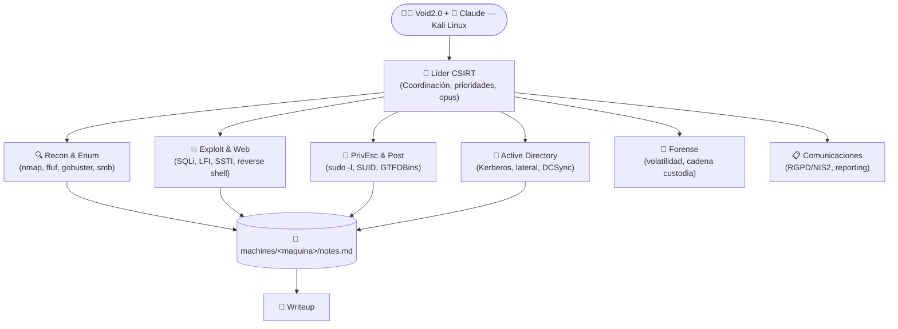

# 🛡️ RedTeam & CTF Labs — Claude Code Squad


Repositorio oficial de laboratorios de **Hacking Ético, Pentesting Ofensivo y Writeups de CTFs** resueltos desde **Kali Linux** utilizando un **Equipo CSIRT de 8 agentes especializados** sobre **Claude Code**.

---

## 🤝 Filosofía: Por qué este repositorio incluye Pistas, Credenciales y Flags

Quien practica en plataformas como **DockerLabs** o **HackMyVM** sabe lo frustrante que es quedarse atascado horas en un paso intermedio sin saber si el vector es un *rabbit hole* o un fallo de sintaxis.

Por eso, todos los writeups de este repositorio están documentados con un enfoque **100% práctico y de ayuda a la comunidad**:
1. **💡 Pista Clave / Anti-Rabbit Hole al inicio:** Para quien solo necesita un pequeño empujón sin leerse todo el spoiler.
2. **Comandos Reales y Reproducibles:** Desde el primer escaneo `nmap` hasta la estabilización de la TTY y la escalada a `root`.
3. **Credenciales y Flags Incluidas (`user.txt` / `root.txt`):** Para que puedas verificar tus resultados o desbloquearte si una máquina te impide avanzar en tu aprendizaje.

---

## 🧠 Arquitectura del Equipo CSIRT (8 agentes)

A diferencia de usar una IA como un simple chat genérico, este workspace opera bajo un equipo CSIRT **definido globalmente** en `~/.claude/agents/` que divide cada máquina en roles especializados coordinados por un Líder:



> **Nota sobre "Void2.0"**: es el alias de **Víctor** ([@Bitxogm](https://github.com/Bitxogm)), operador humano de este laboratorio. No tiene relación con el editor de código *Void*.

> **MCP server integrado**: `csirt-lab-gate` (ejecutable local en `~/redteam/.mcp/lab_mcp_server.py`) expone a los agentes las herramientas `lab_nmap_scan`, `lab_web_enum` y `lab_http_inspect` con **Safety Gate por código**: cualquier objetivo fuera de rangos IPv4 privados (RFC1918 + loopback 127.0.0.0/8) es rechazado antes de ejecutar. Se registró globalmente con `claude mcp add --scope user` el 2026-10-27.

| Rol | Agente | Misión Principal en el Laboratorio |
| :--- | :--- | :--- |
| **🎯 Líder** | `~/.claude/agents/lider.md` | Coordina la metodología, clasifica severidad, prioriza vectores (`RCE > Credenciales > SUID > Escalada > Escape contenedor`) y delega en los especialistas. No ejecuta explotación. |
| **🔍 Recon & Enum** | `~/.claude/agents/recon-enum.md` | Descubrimiento de puertos TCP/UDP (`nmap`), fuzzing web (`ffuf`, `gobuster`), tecnologías (`whatweb`, `wpscan`) y enumeración de servicios (SMB, LDAP, NFS, SNMP). Punto de partida obligatorio en toda máquina nueva. |
| **💥 Exploit & Web** | `~/.claude/agents/exploit-web.md` | Explotación de vulnerabilidades web/servicios, adaptación de PoCs, fuerza bruta/cracking (`hydra`, `john`, `hashcat`) y estabilización de reverse shell. |
| **👑 PrivEsc & Post** | `~/.claude/agents/privesc.md` | Enumeración interna post-foothold, abuso de `sudo -l`, binarios SUID (**GTFOBins**), Linux Capabilities (`getcap`), tareas cron (`pspy`) y pivoting a servicios internos. |
| **🏰 Active Directory** | `~/.claude/agents/activedirectory.md` | Pentesting Windows/AD: enumeración LDAP, Kerberoasting, AS-REP Roasting, Pass-the-Hash, movimiento lateral, DCSync y abuso de ACL/GPO. |
| **🔬 Forense** | `~/.claude/agents/forense.md` | Preservación de evidencia siguiendo el orden de volatilidad (RAM > Red > Procesos > Disco) con cadena de custodia completa. |
| **📋 Comunicaciones** | `~/.claude/agents/comms.md` | Reporting ejecutivo, cumplimiento normativo (RGPD / NIS2), traducción técnica→negocio y distinción clara entre lab/CTF e incidente real. |
| **📝 Writeup** | `~/.claude/agents/writeup.md` | Redacción de writeups técnicos publicables (GitHub, blog, comunidad HackMyVM/HTB/THM) con comandos exactos y placeholders para credenciales reales. |

---

## 📚 Índice de Writeups por Plataforma

- 🐳 **[Writeups de DockerLabs](./writeups/dockerlabs/README.md)** — Máquinas contenedorizadas de todos los niveles (Muy Fácil → Difícil).
- 🏴‍☠️ **[Writeups de HackMyVM](./writeups/hackmyvm/README.md)** — Máquinas virtuales vulnerables orientadas a CTF y Boot2Root.

---

## 📂 Estructura del Repositorio

```text
~/redteam/
├── CLAUDE.md                                  # Contexto del proyecto (estructura machines/, formato respuesta por fase)
├── README.md                                  # Este fichero
├── .mcp/
│   ├── lab_mcp_server.py                      # MCP server csirt-lab-gate (Safety Gate IPv4 privadas)
│   └── .venv/                                 # Entorno Python aislado del server
├── machines/                                  # Área de trabajo técnico por máquina
│   └── <plataforma>-<nombre>/
│       ├── nmap/                              # Escaneos de puertos y servicios
│       ├── web/                               # Resultados de fuzzing (ffuf, gobuster, código descargado)
│       ├── exploits/                          # Scripts, payloads, webshells, PoCs modificados
│       ├── loot/                              # Hashes, credenciales, claves SSH, flags encontradas
│       └── notes.md                           # Bitácora viva gestionada por el Líder
└── writeups/
    ├── TEMPLATE-writeup.md                    # Plantilla estándar (pistas, comandos, flags)
    ├── dockerlabs/                            # Writeups públicos de DockerLabs
    └── hackmyvm/                              # Writeups públicos de HackMyVM
```

> Los **agentes del equipo CSIRT no viven en este repositorio** — están definidos globalmente en `~/.claude/agents/` para que apliquen también a `~/csirt/` y a cualquier otro workspace. Este repo sólo contiene el contexto específico del proyecto de pentest y las máquinas resueltas.

---

## 🚀 Cómo usar esta configuración con Claude Code

**Requisitos previos**:
- [Claude Code](https://claude.com/claude-code) instalado en Kali Linux
- Equipo CSIRT configurado en `~/.claude/agents/` (ver `~/.claude/CLAUDE.md` de esta máquina)
- MCP server registrado: `claude mcp add --scope user csirt-lab-gate ~/redteam/.mcp/.venv/bin/python ~/redteam/.mcp/lab_mcp_server.py`

**Pasos**:

1. Clona este repositorio:
   ```bash
   git clone https://github.com/Bitxogm/redteam-agy-labs.git ~/redteam
   ```
2. Abre el workspace con Claude Code:
   ```bash
   cd ~/redteam && claude
   ```
3. Al arrancar, Claude Code carga automáticamente:
   - [`CLAUDE.md`](./CLAUDE.md) local (estructura `machines/` y formato de respuesta por fase)
   - `~/.claude/agents/*.md` (los 8 agentes del equipo CSIRT)
   - MCP server `csirt-lab-gate` (con Safety Gate activo)

No hace falta alias especial. Si prefieres uno rápido, añádelo a `~/.zshrc`:
```zsh
alias claude-redteam='cd ~/redteam && claude'
```

---

> ⚠️ **Aviso Legal (Disclaimer):** Todo el contenido, técnicas, scripts y writeups de este repositorio han sido desarrollados y ejecutados exclusivamente en entornos de laboratorio controlados y autorizados (**DockerLabs, HackMyVM, TryHackMe, HackTheBox**) con fines educativos y de formación en ciberseguridad.
