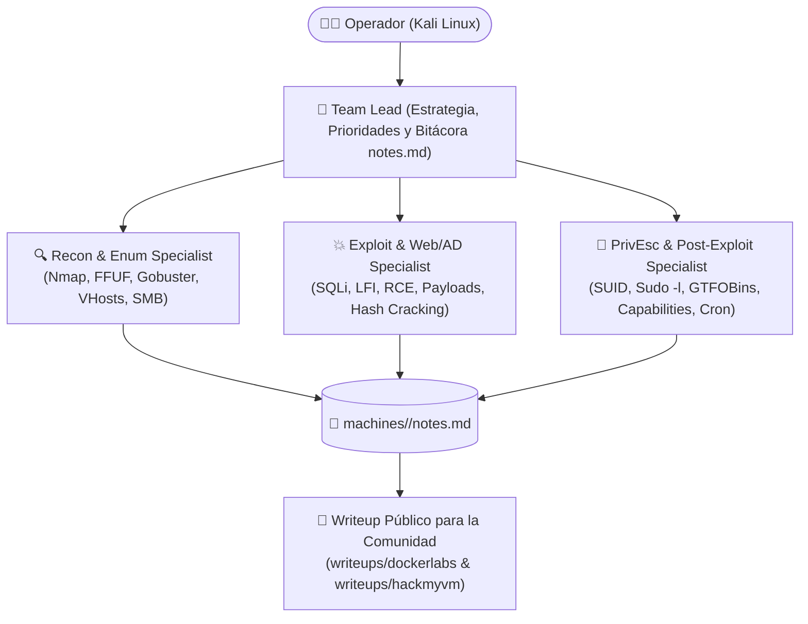

# 🛡️ RedTeam & CTF Labs — Antigravity / Gemini Squad


Repositorio oficial de laboratorios de **Hacking Ético, Pentesting Ofensivo y Writeups de CTFs** resueltos desde **Kali Linux** utilizando un **Equipo Multi-Agente de 4 Especialistas** configurado de forma nativa sobre **Google Antigravity (`agy` CLI & Desktop App)**.

---

## 🤝 Filosofía: Por qué este repositorio incluye Pistas, Credenciales y Flags

Quien practica en plataformas como **DockerLabs** o **HackMyVM** sabe lo frustrante que es quedarse atascado horas en un paso intermedio sin saber si el vector es un *rabbit hole* o un fallo de sintaxis.

Por eso, todos los writeups de este repositorio están documentados con un enfoque **100% práctico y de ayuda a la comunidad**:
1. **💡 Pista Clave / Anti-Rabbit Hole al inicio:** Para quien solo necesita un pequeño empujón sin leerse todo el spoiler.
2. **Comandos Reales y Reproducibles:** Desde el primer escaneo `nmap` hasta la estabilización de la TTY y la escalada a `root`.
3. **Credenciales y Flags Incluidas (`user.txt` / `root.txt`):** Para que puedas verificar tus resultados o desbloquearte si una máquina te impide avanzar en tu aprendizaje.

---

## 🧠 Arquitectura del Equipo Multi-Agente (Antigravity Squad)

A diferencia de usar una IA como un simple chat genérico, este repositorio incorpora una arquitectura de **Reglas (`GEMINI.md`)**, **Skills (`.agents/skills/`)** y **Subagentes Especializados (`.agents/agents/`)** que dividen cada máquina en 4 roles ofensivos coordinados:



| Rol | Agente / Archivo | Misión Principal en el Laboratorio |
| :--- | :--- | :--- |
| **🎯 Team Lead** | [`GEMINI.md`](./GEMINI.md) | Coordina la metodología, evita *rabbit holes*, prioriza vectores (`RCE > Credenciales > Web > PrivEsc`) y redacta el writeup final. |
| **🔍 Recon & Enum** | [`.agents/agents/recon-enum.md`](./.agents/agents/recon-enum.md) | Descubrimiento de puertos TCP/UDP (`nmap`), fuzzing web (`ffuf`, `gobuster`), tecnologías (`whatweb`, `wpscan`) y enumeración de servicios. |
| **💥 Exploit & Web/AD** | [`.agents/agents/exploit-specialist.md`](./.agents/agents/exploit-specialist.md) | Explotación de vulnerabilidades web/servicios, adaptación de PoCs, fuerza bruta/cracking (`hydra`, `john`, `hashcat`) y reverse shell. |
| **👑 PrivEsc & Post** | [`.agents/agents/privesc-post.md`](./.agents/agents/privesc-post.md) | Enumeración interna post-acceso, abuso de `sudo -l`, binarios SUID (**GTFOBins**), Linux Capabilities (`getcap`), tareas cron (`pspy`) y pivoting. |

---

## 📚 Índice de Writeups por Plataforma

- 🐳 **[Writeups de DockerLabs](./writeups/dockerlabs/README.md)** — Máquinas contenedorizadas de todos los niveles (Muy Fácil → Difícil).
- 🏴‍☠️ **[Writeups de HackMyVM](./writeups/hackmyvm/README.md)** — Máquinas virtuales vulnerables orientadas a CTF y Boot2Root.

---

## 📂 Estructura del Repositorio

```text
redteam-agy-labs/
├── GEMINI.md                                  # Protocolo maestro del Equipo RedTeam (cargado al abrir el proyecto)
├── .agents/
│   ├── agents/                                # Definiciones de los subagentes especialistas
│   │   ├── recon-enum.md                      # 🔍 Especialista en Reconocimiento y Enumeración
│   │   ├── exploit-specialist.md              # 💥 Especialista en Explotación y Foothold
│   │   └── privesc-post.md                    # 👑 Especialista en Escalada de Privilegios (Root)
│   └── skills/
│       └── pentest-team/
│           └── SKILL.md                       # Runbook automatizado de organización de máquinas y despliegue
├── machines/                                  # Área de trabajo técnico por máquina (nmap, web, exploits, loot, notes.md)
│   └── TEMPLATE-notes.md                      # Plantilla de bitácora en vivo durante la intrusión
└── writeups/                                  # Writeups finalizados paso a paso para la comunidad
    ├── TEMPLATE-writeup.md                    # Plantilla estándar de Writeup (con pistas, comandos y flags)
    ├── dockerlabs/                            # Writeups de DockerLabs
    │   └── README.md
    └── hackmyvm/                              # Writeups de HackMyVM
        └── README.md
```

---

## 🚀 Cómo usar esta configuración con Google Antigravity

Si utilizas **Google Antigravity** (tanto desde la terminal con `agy` como desde la App de escritorio o el IDE en Kali Linux):

1. Clona este repositorio:
   ```bash
   git clone https://github.com/Bitxogm/redteam-agy-labs.git ~/redteam
   ```
2. Crea un alias rápido en tu `~/.zshrc`:
   ```zsh
   alias agy-sec='cd ~/redteam && agy'
   ```
3. Al iniciar `agy-sec` (o abrir `~/redteam` como Workspace en Antigravity App), el motor detecta automáticamente [`GEMINI.md`](./GEMINI.md) y el directorio [`.agents/`](./.agents/), activando el **Equipo RedTeam de 4 Especialistas** sin necesidad de pegar prompts manualmente.

---

> ⚠️ **Aviso Legal (Disclaimer):** Todo el contenido, técnicas, scripts y writeups de este repositorio han sido desarrollados y ejecutados exclusivamente en entornos de laboratorio controlados y autorizados (**DockerLabs, HackMyVM, TryHackMe, HackTheBox**) con fines educativos y de formación en ciberseguridad.
